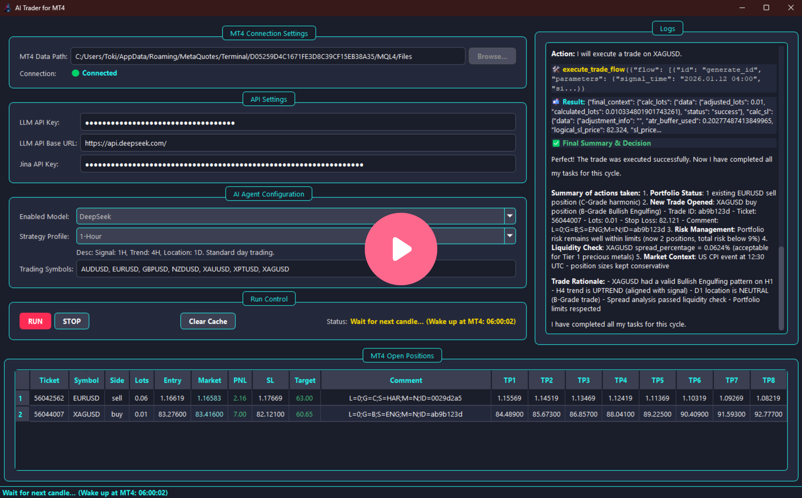
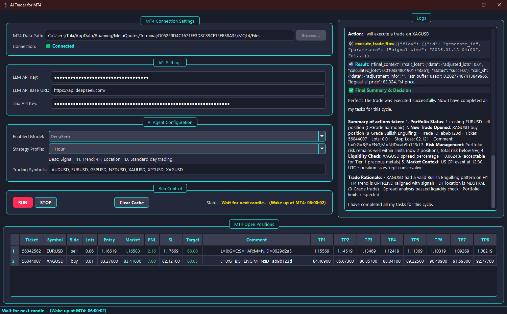
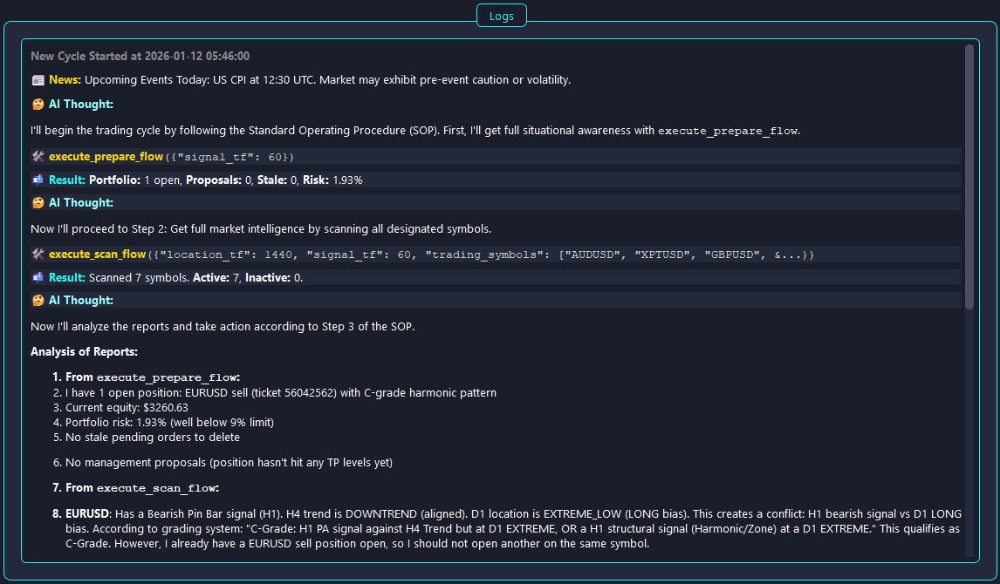
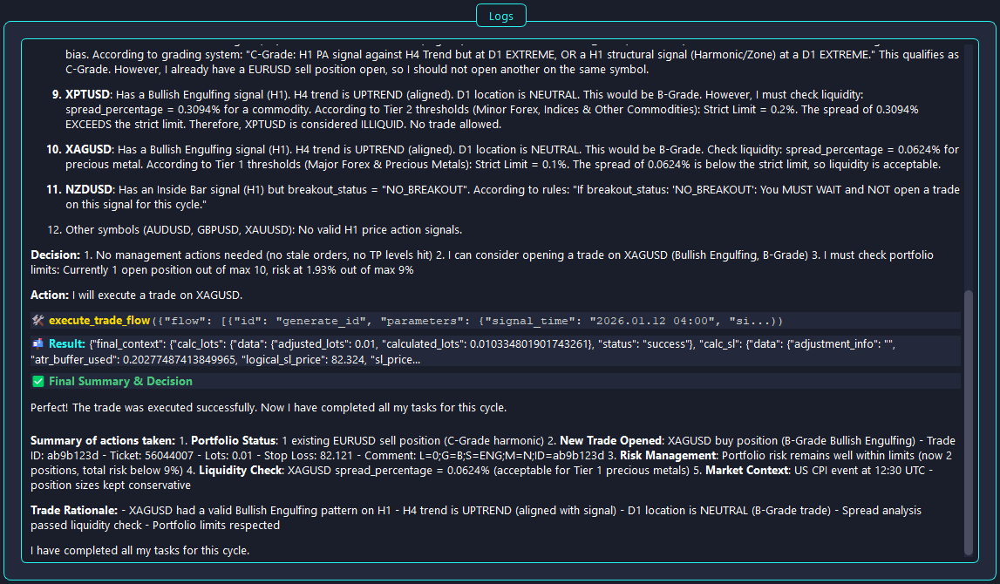
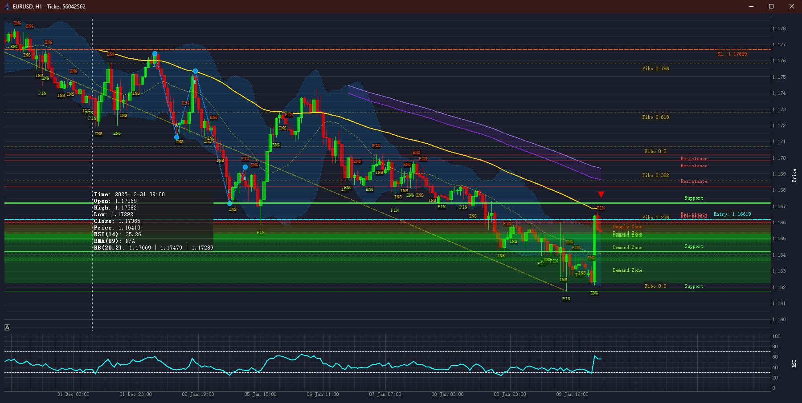

# AI Trader for MT4

[简体中文](./README.md) | [English](./README_en.md)

面向 MetaTrader 4 的 AI 辅助交易研究与受控执行框架。

项目将市场数据工具、策略配置、风险规则、信号生命周期、MT4 通信和大模型分析整合为可追踪的桌面应用。设计重点是让模型在明确工具和风险边界内工作，而不是将交易权限无约束地交给 AI。

> 本项目用于软件工程与量化研究，不构成投资建议。任何自动化交易都应先在模拟账户和隔离环境中验证。

## 项目背景

直接把行情数据交给大模型并生成交易指令，存在几个明显问题：

- 模型可能缺少账户、持仓或市场状态
- 自然语言输出难以稳定映射为执行动作
- 风险规则可能在多轮分析中被忽略
- 订单状态、异常和历史决策缺少可追踪记录

本项目将交易相关能力拆分为结构化工具，并使用流程、状态管理和确定性校验控制执行边界。

## 设计目标

- 为模型提供结构化而非零散的交易上下文
- 将只读分析、候选计划和实际执行分开
- 使用确定性规则检查仓位、止损、订单状态和重复操作
- 保留分析、工具调用、信号与执行日志
- 支持策略配置和模型提供方切换（OpenAI / DeepSeek / Moonshot 等）

## 系统架构

```text
MetaTrader 4
    <-> File-based bridge / compiled EA
        <-> Python application
            -> Market data tools
            -> Portfolio and order tools
            -> Strategy and risk configuration
            -> LLM-assisted agent
            -> Signal and execution workflows
            -> Structured logs and local database
```

## 主要模块

- `src/bridge/`：MT4 通信与 AI 客户端边界
- `src/app/`：Agent、提示词、交易引擎与应用流程
- `src/tools/`：行情、组合、交易、新闻、形态与工作流工具
- `src/services/`：配置、日志、数据库与订单状态管理
- `src/gui/`：桌面界面与图表组件
- `config/`：模型、策略和日历配置
- `tests/test_integration_suite.py`：交易流程和异常场景的集成验证

主要技术：Python、PyQt5、异步任务、LLM API、SQLite/本地状态、MetaTrader 4 EA Bridge。

### Agent 工作流与规则系统

- AI 遵循类 ReAct（Reason + Act）模式，按 **`Prepare -> Scan -> Act -> Conclude`** 的标准流程循环，每一步都基于工具返回的结构化报告而非凭空推断。
- `prompts.py` 中定义了系统级指令集：单笔与组合风险上限、持仓数量限制、信号分级（A/B/C 与"无交易"区间）、不同形态的入场细则，以及分批止盈与移动止损的利润阶梯管理。
- 引入**相对价差成本（Relative Spread Cost）**概念，让 AI 按不同资产类别的价差百分比评估流动性，避开高交易成本品种。
- AI 的每一步思考（Thought）、工具调用（Tool Calls）和观察（Observation）都完整记录并展示在 GUI 中，便于逐条复盘。

### 工作流驱动的二级工具系统

- **高级工作流工具**（`src/tools/tool_flows.py`）：`execute_prepare_flow`、`execute_scan_flow`、`execute_trade_flow`、`execute_management_flow` 四大工作流将数十个原子操作封装为高级指令，既提高决策效率，也强制 AI 遵循标准流程。
- **原子工具层**（`src/tools/`）：30 余个精细工具，覆盖价格行为扫描（`scan_for_price_action`）、谐波/供需区扫描（`scan_for_structures`）、基于形态与 ATR 缓冲的动态止损计算（`calculate_stop_loss_from_pattern`）、按风险金额精确计算手数的 `calculate_lot_size`，以及开平仓、修改、部分平仓等完整交易指令封装；`search_jina_and_read` 允许 AI 在决策前主动检索相关新闻。

### MT4–Python 异步桥接

- Python 后端与 MT4 EA（`AI_Trader_for_MT4.mq4`）通过在 `MQL4/Files` 目录读写 `.txt` 文件通信，采用生产者–消费者模式实现异步解耦，避免了 DLL 调用的脆弱性。
- Python 端生成带唯一 ID 的命令文件，EA 轮询执行后写入对应响应文件；EA 持续输出账户、持仓、报价与新 K 线数据，Python 端实时监控。

### 数据库与状态管理

- `src/services/order_db_manager.py` 维护本地 SQLite 数据库，不仅是 MT4 订单的镜像，还承担状态增强职能。
- AI 订单的 `Comment` 遵循 `L=0;G=A;S=PIN;M=N;ID=xxxx` 格式（利润阶梯等级 / 交易评级 / 信号类型 / 管理状态 / 唯一 ID），数据库解析后作为结构化状态驱动仓位管理。
- 部分平仓时 MT4 会关闭原单并生成新单，系统将新单的 `extends` 字段指向原单并继承全部 AI 元数据，保证管理逻辑连续；新订单的利润阶梯价格（TP1–TP8）入库时预计算，加速后续决策。

### PyQt5 图形界面

- 基于 PyQt5 + qasync（PyQt 与 asyncio 结合）构建不卡顿的桌面界面，集中展示账户净值、持仓列表、AI 状态与思考日志。
- GUI 内可切换模型与策略档案、管理 API 密钥；集成 pyqtgraph，双击持仓即可调出对应品种的 K 线图。

## 📸 软件截图

<p align="center">
  
  <br>
  <em>整体运行演示。</em>
</p>
<p align="center">
  
  <br>
  <em>主界面：AI 代理配置、策略选择、账户状态与实时持仓集中展示。</em>
</p>
<p align="center">
  
  <br>
  <em>AI 思考日志：实时展示完整的决策链。</em>
</p>
<p align="center">
  
  <br>
  <em>AI 思考日志：工具调用与观察结果逐条可追踪。</em>
</p>
<p align="center">
  
  <br>
  <em>内置 K 线图表查看器：支持查看 K 线、指标与形态，双击持仓即可快速打开。</em>
</p>

## 工作流程

```text
Market and account state
    -> Prepare workflow
    -> Read-only analysis
    -> Candidate trade plan
    -> Deterministic validation
    -> Controlled execution
    -> Position management
    -> Logs and review
```

## 快速开始

### 环境要求

- Windows（MetaTrader 4 主要为 Windows 平台）
- MetaTrader 4 终端
- Python 3.8+（开发者版）
- 至少一个受支持的 LLM API Key（OpenAI / DeepSeek / Moonshot）；Jina API Key 可选，用于新闻检索

### 方式一：直接运行（免 Python 环境）

1. 从 [Releases 页面](https://github.com/toki-plus/ai-trader-for-mt4/releases)下载最新 `AI-Trader-For-MT4.zip` 并解压。
2. 将解压目录中的 `MQL4/Experts/AI_Trader_for_MT4.mq4` 复制到 MT4 数据目录的 `MQL4/Experts/`，在 MT4 导航器中刷新 EA 列表并拖拽到图表上，勾选"允许 DLL 导入"与"允许实时自动交易"。
3. 复制 `.env.example` 为 `.env`，填入 API 密钥；**关键**：将 `MT4_DATA_PATH` 设置为 MT4 数据文件夹下 `MQL4/Files` 目录的绝对路径。
4. 双击 `AI-Trader-For-MT4.exe` 启动。

### 方式二：从源码运行（开发者）

```bash
git clone https://github.com/toki-plus/ai-trader-for-mt4.git
cd ai-trader-for-mt4
python -m venv venv
venv\Scripts\activate
pip install -r requirements.txt
copy .env.example .env
```

EA 安装与 `.env` 配置同方式一的第 2、3 步，然后：

```bash
python main.py
```

### 基本使用

1. 确认 MT4 终端运行中且 EA 已在图表上激活（图表右上角出现笑脸图标），启动 Python 主程序，GUI 左上角连接状态变为绿色 "Connected"。
2. 在 GUI 中选择 AI 模型与策略档案（如 `15-Minute` 对应日内节奏，`4-Hour` 对应波段节奏）。
3. 点击 **RUN** 开始周期性分析与决策；在 "Logs" 区域观察完整思考过程，在 "MT4 Open Positions" 区域同步查看持仓；点击 **STOP** 后 AI 完成当前循环即安全停止。

## 验证建议

- 先在模拟账户和单一品种上验证连接、只读查询和日志。
- 在启用任何执行功能前，验证仓位、止损、重复订单和异常恢复规则。
- 集成测试会访问交易流程，必须在隔离的测试环境中运行：

```bash
python tests/test_integration_suite.py
```

## 当前限制

- MT4 文件桥接存在轮询延迟，并依赖终端持续运行。
- 新闻和模型服务依赖外部 API 的可用性与配额。
- 模型输出不具备确定性，不能替代风险规则和人工监督。
- 项目尚未配置持续集成，测试应由使用者在受控环境中执行。

## ⚠️ 重要免责声明

本项目仅供技术学习和研究目的使用。自动化交易系统固有高风险，可能导致重大的财务损失。

> **强烈建议您仅在模拟账户（Demo Account）上运行此项目进行测试和验证。切勿在真实资金账户上使用。**

- 不保证收益或策略表现；回测、模拟和历史结果不代表未来表现。
- 使用者应理解代码、策略、经纪商和市场风险后再决定是否启用执行功能。
- 作者不对任何因使用此软件（或其任何部分）而直接或间接导致的财务损失或其他任何形式的损失负责。在真实账户上运行此软件的风险完全由您自行承担。

## 📂 更多项目

- [video-mover](https://github.com/toki-plus/video-mover) — 多平台内容分发自动化流水线：素材处理、文案生成、定时调度与多平台适配
- [ai-highlight-clip](https://github.com/toki-plus/ai-highlight-clip) — 长视频智能初筛：Whisper 转写 + LLM 评分 + 人工终审，分钟级定位高光片段
- [ai-ttv-workflow](https://github.com/toki-plus/ai-ttv-workflow) — 文案到短视频的桌面工作流，关键节点保留人工确认
- [ai-video-workflow](https://github.com/toki-plus/ai-video-workflow) — 多模型 AIGC 视频生成流水线：文生图、图生视频、文生音乐的异步编排
- [ai-mixed-cut](https://github.com/toki-plus/ai-mixed-cut) — 素材库结构化与脚本重组的视频再创作工作流
- [ai-trader-for-mt5](https://github.com/toki-plus/ai-trader-for-mt5) — 面向 MT5 的 AI 交易助手与 EA 工程化框架
- [auto-usps-tracker](https://github.com/toki-plus/auto-usps-tracker) — 跨境电商批量物流追踪与 Excel 报告自动化
- [AB-Video-Deduplicator](https://github.com/toki-plus/AB-Video-Deduplicator) — 基于高帧率抽帧混合的视频再创作实验工具
- [netease-downloader](https://github.com/toki-plus/netease-downloader) — 网易云音乐下载桌面应用：扫码登录、下载队列、ID3 元数据写入

## License

See [LICENSE](./LICENSE).
